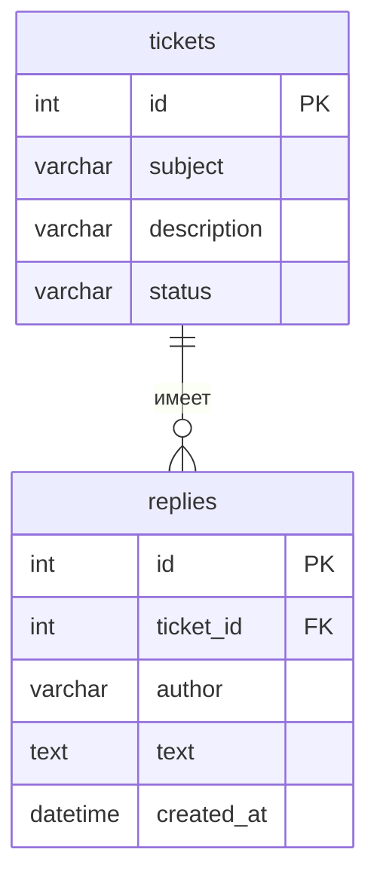

# Служба поддержки

Тема №26: Служба поддержки. Одна фраза: сервис для регистрации и отслеживания обращений клиентов.

| | |
|---|---|
| Главная сущность | Обращение (Ticket) — тема, описание, статус |
| Связанная сущность (1:N) | Ответ (Reply) — будет в лабе 2 |
| Фишка | Фильтрация по статусу и пагинация |
| Стек | Python, Django, Django REST Framework, память |

## Как запустить

```bash

git clone https://github.com/user_name/backend-project1.git
cd backend-project1
py -m venv .venv
.venv\Scripts\activate
pip install -r requirements.txt
py manage.py runserver
```
## Эндпоинты 

| Метод | Путь | Что делает | Ответ |
|---|---|---|---|
| GET | `/health` | Проверка, что сервис жив | 200 `{"status":"ok"}` |
| POST | `/api/tickets` | Создать | 201 и объект с `id`; 400 при ошибке |
| GET | `/api/tickets` | Список | 200 |
| GET | `/api/tickets/{id}` | Получить одну запись | 200; 404 |
| PATCH | `/api/tickets/{id}` | Изменить | 200; 400; 404 |
| DELETE | `/api/tickets/{id}` | Удалить | 204; 404 |
| GET | `/api/tickets/{id}/replies` | Список ответов | 200 |
| POST | `/api/tickets/{id}/replies` | Создать ответ | 201; 409 если обращение закрыто |
| GET | `/api/tickets/stats` | Статистика по ответам | 200 |

## ER-диаграмма



## Индекс и EXPLAIN

Индекс создан на поле `status` (часто используемый фильтр):

```sql
CREATE INDEX idx_ticket_status ON tickets_ticket (status);
```
Проверка через EXPLAIN:

```sql
EXPLAIN QUERY PLAN SELECT * FROM tickets_ticket WHERE status = 'open';
```
Вывод:

text
(3, 0, 0, 'SEARCH tickets_ticket USING INDEX idx_ticket_status (status=?)')
